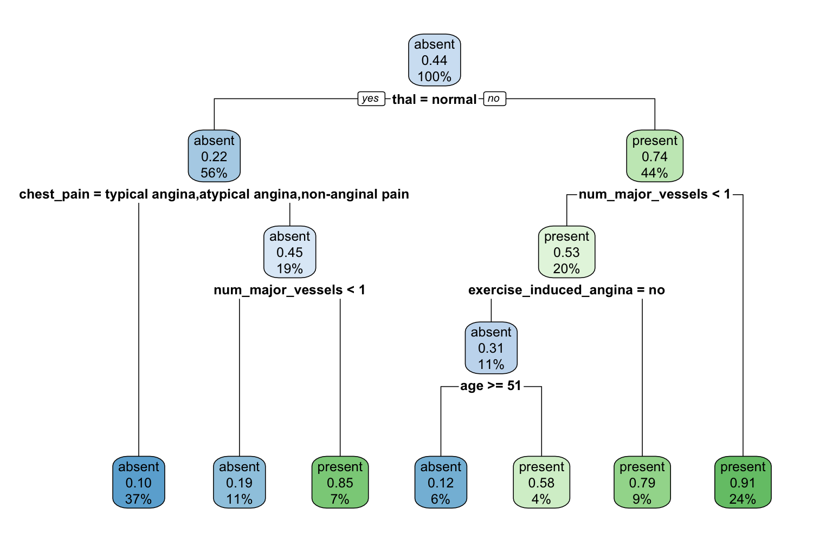
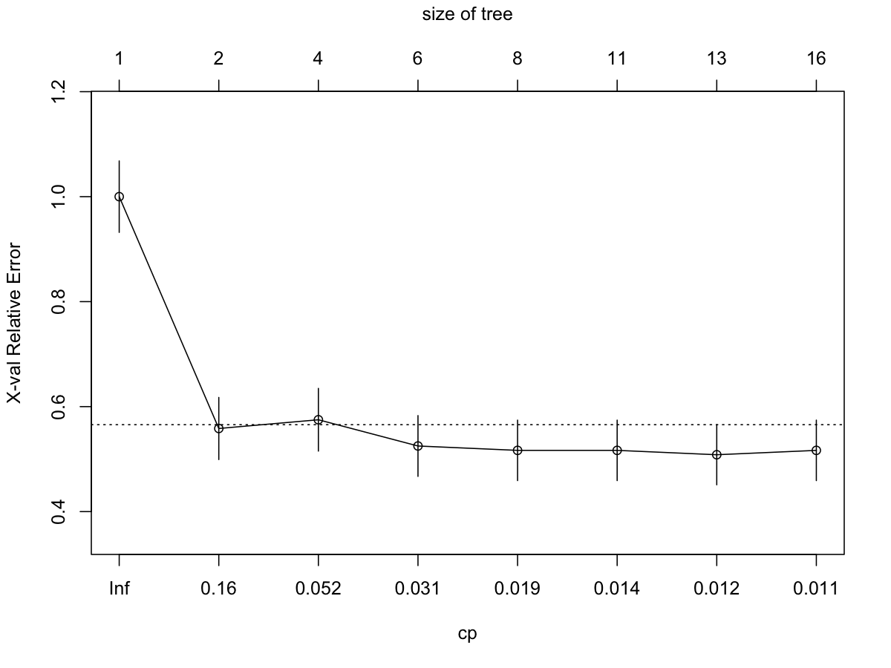
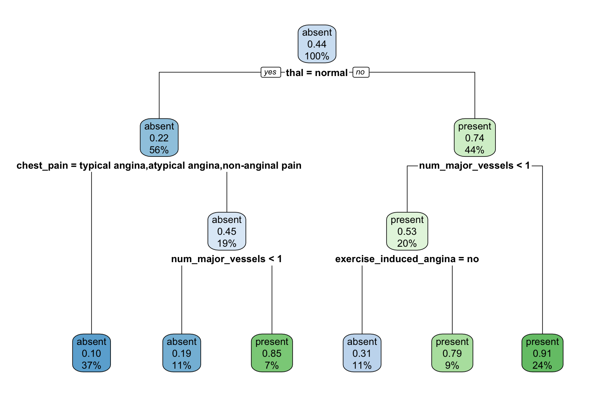
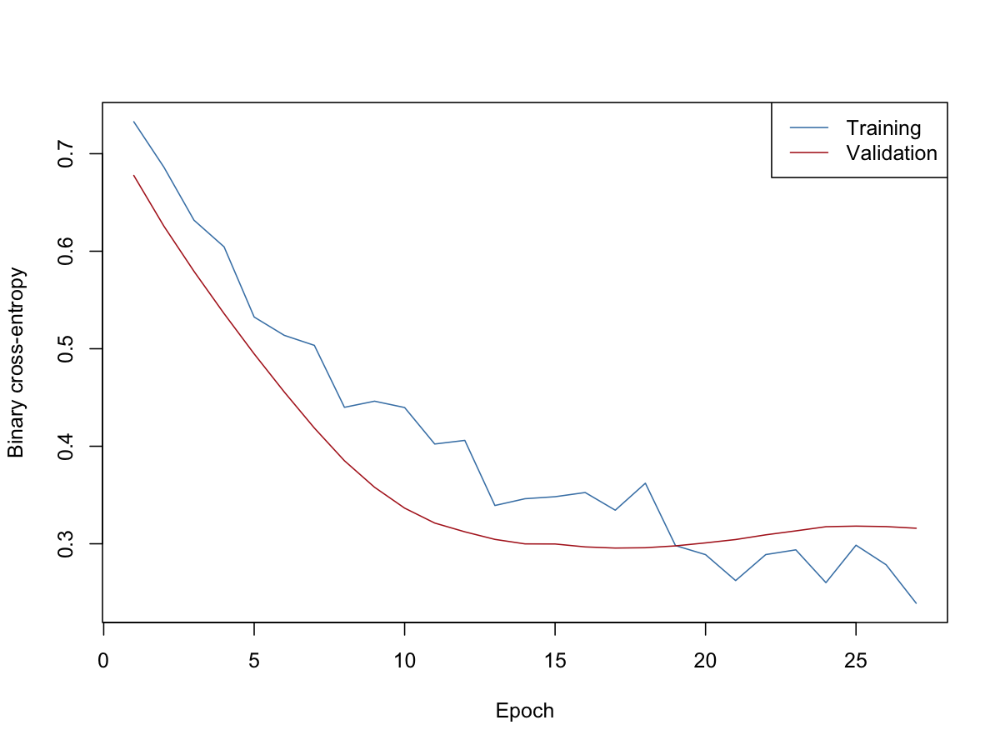
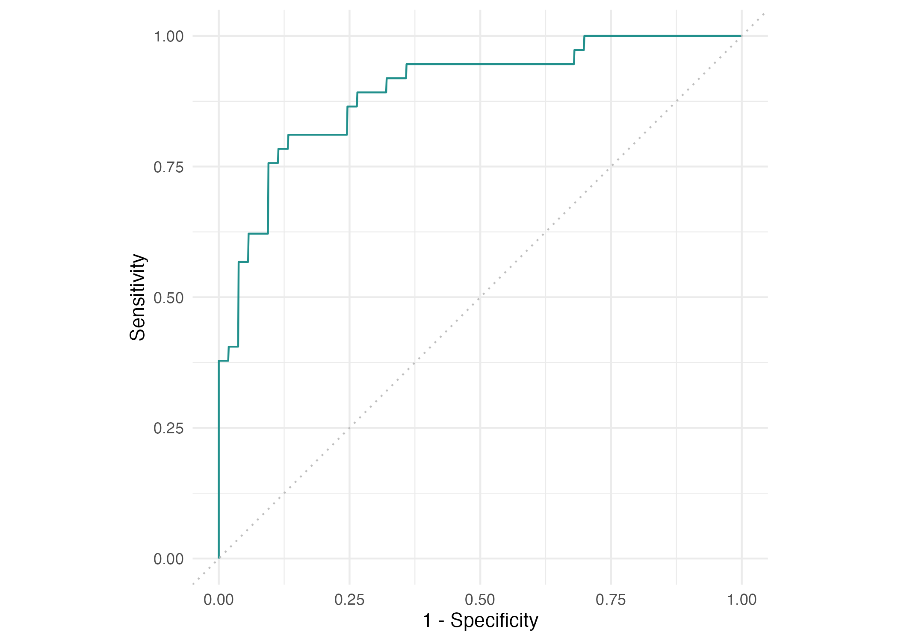
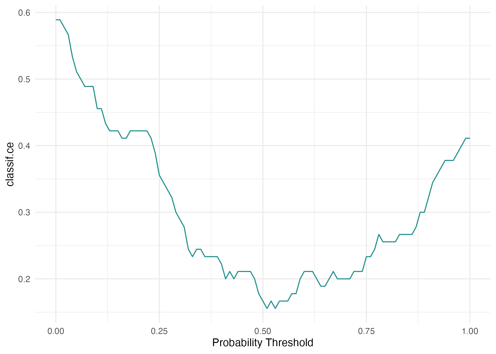
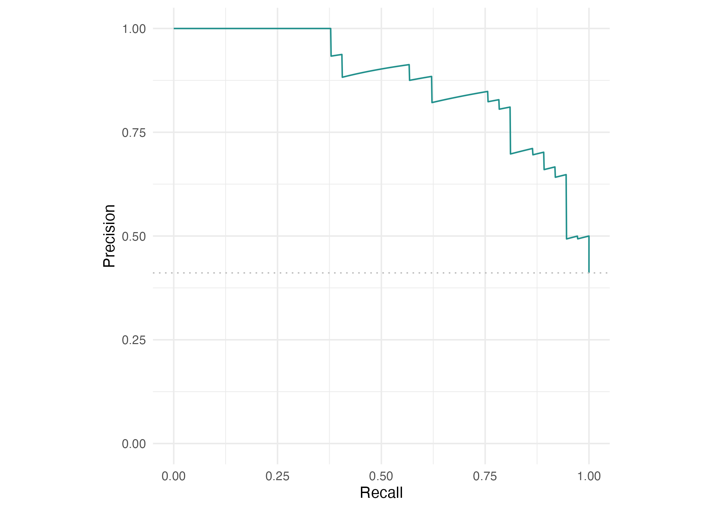

```{r}
#| include: false
knitr::read_chunk("R/02-trees-and-evaluation.R")
```

## From the 28 September 2026 introduction to the article workflow {#from-the-september-introduction-to-the-article-workflow}

In Part 1, we explored how learning works and applied it to West Nile surveillance.
In this session, we use the heart-disease data from
[Wright et al.](https://arxiv.org/html/2602.16352v1) and follow the order of their
published examples. Open `machine-learning-in-epidemiology-with-r.Rproj` from
the repository root in RStudio. This single project contains both parts.
In a fresh project session, run the following in the Console before using the
Part 2 scripts:

```{r}
#| eval: false
setwd("part2")
```

The scripts use `part2/` as their working directory. Quarto runs this notebook
from its own folder when rendering.

This workshop implements the published examples. Implementation details are documented in
[the replication record](references/replication-notes.qmd).
The frozen data and transformation details are in [the data guide](data/guide.qmd).

## 1. Meet the data

The task is to distinguish existing heart disease from its absence using clinical
measurements. This is a classification example, not a future cardiovascular risk score.

```{r, code=readLines("R/01-data.R")}
```

```{r}
dim(heart)
table(heart$heart_disease)
str(heart)
```

There are 270 patients and 13 predictors. The outcome is `heart_disease`, and
`present` is the positive class. Examine age, chest pain, cholesterol and exercise
measurements before discussing what information a learner receives.

## 2. Fit and prune a tree — article section 2.1.3

The [core script](R/02-trees-and-evaluation.R) follows the tree examples, then
continues through evaluation and resampling. Read it section by section in RStudio.
The first trees use the complete dataset for illustration, as in the article;
their fitted accuracy would not estimate performance on new patients.

```{r article-trees}
```

{fig-align="center"}

Compare the default tree with the deep tree. The complexity plot connects pruning
to the balance between fitting the observed sample and generalising beyond it.
The article uses `cp = 0.031`; we retain that value for the replication.

{fig-align="center"}

{fig-align="center"}

## 3. Train a neural network — article section 2.2.3

The [network script](R/03-neural-network.R) retains the published 64/32-unit
architecture, dropout of 0.4, sigmoid output, Adam learning rate of 0.002,
binary cross-entropy, 50 epochs, batches of 32, 20% validation and early stopping
with patience 10. The data guide explains how we construct 22 inputs.

Run this after configuring Keras. It is separate from the default render because
it needs a Python backend.

```{r, code=readLines("R/03-neural-network.R"), eval=FALSE}
```

The script saves training and validation loss and the observed test accuracy.
The paper's reported accuracy is not substituted for a local result.
When a saved network run is available, its results appear below; these files
come from the separate network script, rather than the core notebook render.

```{r}
#| echo: false
#| fig-cap: "Training and validation binary cross-entropy across 27 training epochs."
#| fig-align: center
if (file.exists("outputs/neural-accuracy.csv")) {
  print(read.csv("outputs/neural-accuracy.csv"))
  
}
```

## 4. Evaluate predictions — article section 3.1

We now train a probability-producing random forest on two-thirds of the
observations and evaluate it on the remaining third. These are the results
of our seeded run.

```{r article-evaluation}
```

{fig-align="center"}

{fig-align="center"}

{fig-align="center"}

Discuss sensitivity, specificity, positive and negative predictive value, accuracy
and the consequences of choosing a threshold. A good score does not establish causation.

## 5. Resample — article section 3.2

The next examples use a 100-tree forest, 3-fold cross-validation, 100 repeated
subsamples and 40 bootstrap repetitions. The core script retains those counts.

```{r article-resampling}
```

Training and test AUC answer different questions. Resampling estimates how
performance changes when the training sample changes.

## 6. Tune within the training data — article section 4

The [tuning script](R/04-tuning.R) supplies the missing objects in the published
snippets and retains their search ranges and budgets. Run one method at a time
from a terminal in this folder:

```bash
Rscript R/04-tuning.R grid_search
Rscript R/04-tuning.R random_search
Rscript R/04-tuning.R mbo
Rscript R/04-tuning.R nested
```

The grid uses resolution 10; random search evaluates 500 configurations;
MBO evaluates 30. Nested tuning uses 100 configurations per inner search,
10 inner folds and 10 outer folds. These are substantial runs, so the workshop
can inspect the code before running the full searches outside the live session.
The test set is excluded from search selection.

## 7. Interpret — article section 5

Discuss local explanations, feature effects and feature importance. The article
explains these methods but prints no executable interpretation example.
We do not introduce a different analysis and label it as replicated article code.
Predictive importance describes a fitted model; it does not identify a causal effect.

## 8. Generate synthetic observations — article section 6.2.5

The [synthetic-data script](R/05-synthetic-data.R) follows the adversarial random
forest, density estimation and sampling sequence. Its output is labelled synthetic.

```{r, code=readLines("R/05-synthetic-data.R"), eval=FALSE}
```

Synthetic rows are generated examples, not additional observed patients.

## Reproducibility

Observed results, seeds, split membership and package versions are saved in
`outputs/`. The raw data remain unchanged. See the
[replication record](references/replication-notes.qmd) and
[validation results](outputs/validation.qmd) for differences from the
published snippets and validation status.
